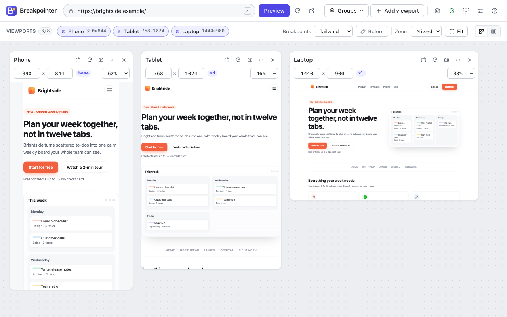
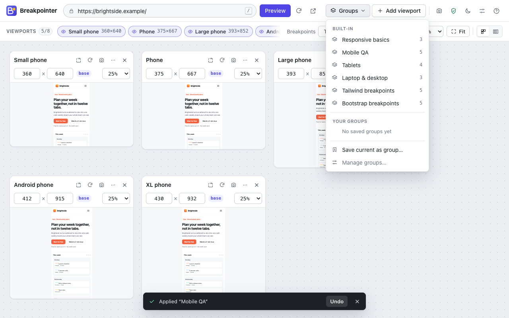

<p align="center"></p>

<p align="center">
  <a href="https://github.com/Tanx-1811/breakpointer/actions/workflows/ci.yml"></a>
</p>

<p align="center">
  <b>Preview websites at multiple viewport sizes and check responsive layouts directly in Chrome.</b><br>
  <a href="#install">Install</a> · <a href="#features">Features</a> · <a href="#keyboard-shortcuts">Shortcuts</a> · <a href="docs/PLAN.md">Plan</a> · <a href="docs/ARCHITECTURE.md">Architecture</a> · <a href="docs/PRIVACY.md">Privacy</a> · <a href="#tiếng-việt">Tiếng Việt</a>
</p>

<p align="center"></p>

Breakpointer is a Chrome extension (Manifest V3) for frontend developers, designers, QA testers and anyone building websites. Each preview gets a **real layout viewport** — media queries, container queries and `window.innerWidth` respond exactly as they would in a window that size. Zoom only scales the finished rendering to fit your screen.

## Features

- **Side-by-side previews** of any http(s) page — up to 8 viewports, wrapping or in a single row.
- **15 presets** for phones, tablets, laptops and desktops, plus **custom sizes** (200–3840 px).
- **Per-viewport controls:** rotate, resize, rename, zoom, reload, duplicate, hide, reorder (menu, drag-and-drop, or `Alt+←/→`), remove with **undo**.
- **Fit** finds the largest zoom at which everything fits on screen.
- **Viewport groups:** save your own (e.g. "Checkout QA") or use six built-in groups, including Tailwind and Bootstrap breakpoint sets.
- **Breakpoint labels** (Tailwind, Bootstrap) and **pixel rulers**.
- **Screenshots** of one preview or the whole visible workspace.
- **Real-window fallback:** open a preview in a new tab or in a window whose content area is exactly the viewport size.
- **Blocked sites:** many sites refuse to be shown in frames. Allow Breakpointer on a site (or all sites) when you need to — never at install.
- **Fast entry points:** toolbar popup ("Preview this page"), right-click on pages and links, `Alt+Shift+P`, or type `bpt` + space in the address bar.
- **Comfortable:** light/dark/system themes, keyboard shortcuts, accessible (WCAG 2.1 AA checks), **English and Vietnamese**.
- **Private:** no account, no analytics, no server; export/import your setup as JSON.

|                                                                                                                              |                                                                                                                                   |
| ---------------------------------------------------------------------------------------------------------------------------- | --------------------------------------------------------------------------------------------------------------------------------- |
|               |  |
|  |                                                   |

> **What it isn't:** Breakpointer changes the viewport size. It doesn't emulate a device's user agent, pixel density, touch input or browser engine, and sign-in state or third-party cookies can behave differently inside previews. See [How previews work](docs/ARCHITECTURE.md#adr-001-how-a-page-is-rendered-at-a-viewport-size).

## Install

**From source (developer mode)**

```sh
git clone https://github.com/Tanx-1811/breakpointer.git
cd breakpointer
npm ci
npm run build
```

Then open `chrome://extensions`, enable **Developer mode**, click **Load unpacked** and choose the `dist/` folder. Requires Chrome 116 or later.

**Chrome Web Store:** coming soon (see the [release plan](docs/PLAN.md#6-release-plan-m3--store)).

## Usage

1. Click the Breakpointer button (or press `Alt+Shift+V`) on any page and choose **Preview this page** — or type an address in the workspace.
2. Add sizes with **Add viewport**, apply a **Group**, or press **Fit** to see everything at once.
3. If a preview is blank or says "refused to connect", the site blocks framing: click **Allow on <site>**, or open it in a new tab or an exact-size window.

## Keyboard shortcuts

| In the workspace |                             | Anywhere in Chrome |                          |
| ---------------- | --------------------------- | ------------------ | ------------------------ |
| `/`              | Focus the address bar       | `Alt+Shift+V`      | Open Breakpointer        |
| `R`              | Reload all previews         | `Alt+Shift+P`      | Preview the current page |
| `A`              | Add viewport                | `bpt` + space      | Address-bar keyword      |
| `G`              | Groups                      |                    |                          |
| `F`              | Fit to screen               |                    |                          |
| `+` / `−`        | Zoom in / out               |                    |                          |
| `L`              | Switch layout               |                    |                          |
| `M`              | Toggle rulers               |                    |                          |
| `S`              | Screenshot of the workspace |                    |                          |
| `T`              | Switch theme                |                    |                          |
| `?`              | Help                        |                    |                          |

Chrome shortcuts can be changed at `chrome://extensions/shortcuts`.

## Permissions & privacy

No permission shows a warning at install. Host access is **optional** and requested only when you allow a site, allow all sites, or take your first screenshot (Chrome requires all-sites access to capture a tab).

| Permission                            | Used for                                                                                                  |
| ------------------------------------- | --------------------------------------------------------------------------------------------------------- |
| `storage`                             | Your viewports, groups and preferences, stored locally                                                    |
| `activeTab`                           | Reading the current tab's address when you invoke Breakpointer                                            |
| `contextMenus`                        | "Preview in Breakpointer" on pages and links                                                              |
| `declarativeNetRequestWithHostAccess` | Letting previews of sites **you allowed** ignore frame-blocking headers, only inside the Breakpointer tab |

Breakpointer collects nothing and sends nothing anywhere. Read the full [privacy policy](docs/PRIVACY.md).

## Development

```sh
npm ci
npm run dev           # rebuild dist/ on change (reload the extension in chrome://extensions)
npm run lint          # ESLint
npm run format        # Prettier
npm run typecheck     # TypeScript
npm test              # unit tests (Vitest)
npm run test:e2e      # end-to-end + accessibility tests (Playwright; run `npx playwright install chromium` once)
npm run build         # production build → dist/
npm run package       # build and zip → release/breakpointer-<version>.zip
npm run screenshots   # regenerate store screenshots from the real UI
npm run brand         # regenerate logos, promo tiles and banners (macOS)
npm run icons         # regenerate extension icons from assets/icon.svg
```

```
src/
  background/   service worker (context menus, omnibox, commands, rule cleanup)
  popup/        toolbar popup
  viewer/       the workspace page
  components/   UI components
  services/     preview adapter, embedding rules, site access, screenshots, storage
  state/        pure state logic (viewports, groups, fit, reducer)
  data/         presets, built-in groups, breakpoints
  i18n/         English and Vietnamese strings
tests/
  unit/         Vitest
  e2e/          Playwright (extension loaded in Chromium)
docs/           plan, architecture, privacy, store listing, testing
brand/          brand guide, logos, store and social images
```

Read [ARCHITECTURE.md](docs/ARCHITECTURE.md) before changing how previews render or which permissions are used, and the [plan](docs/PLAN.md) for scope, decisions and the roadmap.

## Roadmap

V1 covers the preview workflow. Next, driven by feedback: synchronized scrolling, an overflow/element inspector, visual regression baselines, and optional sharing — see [docs/PLAN.md](docs/PLAN.md#9-roadmap-after-v1-ideas-ordered-by-expected-value).

## License

No license has been chosen yet; all rights reserved by the author.

---

## Tiếng Việt

**Breakpointer** là tiện ích Chrome giúp xem trước website ở nhiều kích thước viewport cùng lúc. Mỗi bản xem trước có **viewport dàn trang thật**, nên media query và bố cục responsive hoạt động đúng như trong một cửa sổ cùng kích thước.

**Tính năng chính:** xem song song tối đa 8 viewport · 15 kích thước có sẵn và kích thước tùy chỉnh · xoay, đổi kích thước, đổi tên, nhân bản, ẩn/hiện, sắp xếp, hoàn tác · "Vừa màn hình" · nhóm viewport (tự lưu hoặc 6 nhóm có sẵn) · nhãn breakpoint Tailwind/Bootstrap và thước đo · chụp ảnh · mở cửa sổ đúng kích thước · menu chuột phải, phím tắt, gõ `bpt` + dấu cách trên thanh địa chỉ · giao diện sáng/tối · **tiếng Việt và tiếng Anh** · không thu thập dữ liệu.

**Cài đặt từ mã nguồn:** chạy `npm ci && npm run build`, mở `chrome://extensions`, bật **Chế độ dành cho nhà phát triển**, chọn **Tải tiện ích đã giải nén** và trỏ tới thư mục `dist/`.

**Cách dùng:** bấm nút Breakpointer (hoặc `Alt+Shift+V`) trên trang bất kỳ và chọn **Xem trước trang này**. Nếu bản xem trước trống hoặc báo "refused to connect", trang đó chặn hiển thị trong khung: bấm **Cho phép trên <trang>**, hoặc mở trong tab mới / cửa sổ đúng kích thước.

**Quyền riêng tư:** không tài khoản, không theo dõi, không máy chủ; quyền truy cập trang là tùy chọn và có thể gỡ bất cứ lúc nào. Xem [chính sách quyền riêng tư](docs/PRIVACY.md) và [kế hoạch sản phẩm](docs/PLAN.md).
