<p align="center">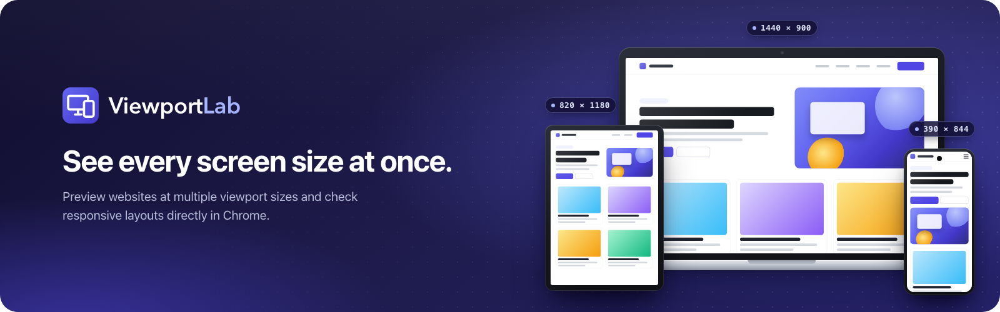</p>

<p align="center">
  <a href="https://chromewebstore.google.com/detail/naoadcallefanlcneemohjepkficejjh?utm_source=github&amp;utm_medium=readme&amp;utm_campaign=badge"></a>
  <a href="https://chromewebstore.google.com/detail/naoadcallefanlcneemohjepkficejjh?utm_source=github&amp;utm_medium=readme&amp;utm_campaign=badge"></a>
  <a href="https://github.com/Tanx-1811/breakpointer/actions/workflows/ci.yml"></a>
</p>

<p align="center">
  <b>Responsive design tester: preview any site at many screen sizes side by side and find the exact width where your layout breaks.</b><br>
  <a href="#install">Install</a> · <a href="#features">Features</a> · <a href="#keyboard-shortcuts">Shortcuts</a> · <a href="docs/PLAN.md">Plan</a> · <a href="docs/ARCHITECTURE.md">Architecture</a> · <a href="docs/PRIVACY.md">Privacy</a> · <a href="#tiếng-việt">Tiếng Việt</a>
</p>

<p align="center">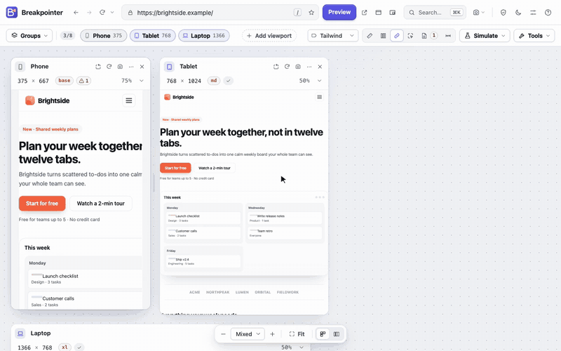</p>

Breakpointer is a Chrome extension (Manifest V3) for frontend developers, designers, QA testers and anyone building websites. Each preview gets a **real layout viewport** — media queries, container queries and `window.innerWidth` respond exactly as they would in a window that size. Zoom only scales the finished rendering to fit your screen.

## Features

- **Side-by-side previews** of any http(s) page — up to 8 viewports, wrapping or in a single row, with a real layout width and height each.
- **Check pages** (`B`): a whole list of pages — your saved pages, the links on the page you're previewing, or the site's sitemap — checked at every viewport in one run. A table shows which pages break and at which sizes; open any page from it, copy it as Markdown or download an HTML report.
- **Showcase image**: your page at several sizes in simple device frames (or browser windows) on a backdrop — for a portfolio, a client or a post. Download a crisp PNG or copy it.
- **Scan every width** (`W`): the page is checked at every width of a range and each issue's first and last width is found **to the pixel** — on a chart with the page's height, this site's breakpoints and your viewports. Jump to the worst width and add a viewport there in one click.
- **Responsive score**: one number from 0 to 100 (graded A–F) for every page, with what costs the most points — in the audit, reports and Check pages.
- **Notes & bug reports** (`N`): pin what's wrong on any preview and copy a Markdown bug report with the page, the browser, each viewport's size and your notes — or save every preview with its notes as one image.
- **Projects**: save a site's whole setup — page, viewports, breakpoints, grid, live CSS and comparison — and switch between clients in one click (one free, unlimited with Pro).
- **Audit** (`E`): every issue of every preview in one place, **page weight, requests, image pixels, LCP and layout shift** as bars per size, the **type scale** (headings, text, buttons) at every size, every **image** against the width it is shown at — too large, too small or right, with a **suggested `sizes` and `srcset`** to copy — and the page's **colours** for text, backgrounds and borders (copied as CSS variables) — each copied as a Markdown table.
- **Visual check** (`V`): save a **baseline** of every viewport, compare later and see what moved, pixel by pixel — side by side, with a slider, or the differences boxed. Baselines stay in your browser.
- **28 presets** for phones, foldables, tablets, laptops and desktops (searchable, with aspect-ratio thumbnails), plus **custom sizes** (200–3840 px).
- **Drag to resize:** pull a preview's edge and watch the page reflow live; edges **snap to breakpoints** with guides and a live size read-out (also from the keyboard).
- **Command palette** (`Ctrl/⌘ + K`): every action, preset, group, page and setting in one search — or type an address to preview it.
- **Inspector:** click an element in one preview and compare its size, display, font, spacing and flex/grid layout **at every size**, with what changes highlighted — and the **distance to a second element** at every size.
- **Tour:** a short walk through the workspace's main controls, from the welcome screen, Help or the command palette.
- **This site's breakpoints:** reads the widths in the page's own media queries — label viewports with them, snap to them and test both sides of each.
- **Light and dark side by side:** show any preview with the page's light or dark styles (`prefers-color-scheme`), whatever your browser prefers.
- **Synced scrolling and navigation:** scroll or follow a link in one preview and the others follow — keeping the **same content** in view.
- **Responsive checks** on every card: sideways overflow and its culprits, missing viewport tag, tiny text, small touch targets, **text cut off by its box**, **low-contrast text** (WCAG AA, any CSS colour space), blurry (upscaled) images, fixed elements covering the screen and **layout shifts** — with **highlight** in the page; switch each one on or off.
- **Compare two addresses:** a second preview, **B**, next to every viewport — the same page on staging next to production (B follows A to other pages), or any fixed address; swap A and B in one click.
- **Simulate:** colour vision deficiencies (no red, green, blue or colour) and blurred vision on any site; **prefers-reduced-motion** styles and **paused animations**; and **layout stress tests** — pseudo-translated text about 40% longer, and right-to-left.
- **Real windows, a floating preview and a side panel:** open every viewport as an exact-size Chrome window (for sites that need your sign-in or refuse previews), keep an always-on-top phone preview next to your editor, or preview the page you're browsing in Chrome's side panel.
- **Full-page screenshots** of any preview, **text spacing** (WCAG), **prefers-contrast** and **print styles** simulations, **image size** and **tab order** labels in the page, and a **baseline grid**.
- **Measure** any area of a preview in CSS pixels, a **colour contrast checker** with an eyedropper and WCAG AA/AAA grades, and a **design overlay** to compare a mockup with the page pixel by pixel.
- **Layout outlines**, **grid & flex overlays**, **live CSS** for every preview at once (with **saved snippets**), a **column grid**, **pixel rulers** with breakpoint marks, and **hidden scrollbars** like on phones.
- **Inspector extras:** margin and padding on hover, and **capture the element at every size** in one image at the same scale.
- **Breakpoint labels** (Tailwind, Bootstrap, Material UI, Chakra UI, Ant Design, Bulma, Foundation, your own or this site's) and **Test breakpoint edges**; built-in groups for the **most-used sizes** and **WCAG reflow**.
- **Text at 200%** (WCAG 1.4.4) next to the other stress tests.
- **Focus mode** for one viewport (`1`–`8` jump straight to one), **back/forward** between previewed pages, **rotate all**, **sort by width**, light or dark **page colours for every preview** at once, `Ctrl/⌘ + wheel` zoom and `Space + drag` pan.
- **Reloads keep your place** in every preview, and can run **automatically** every few seconds; **workspace links** open a page with your viewports for a teammate.
- **Screenshots** of one preview or the workspace, **all viewports in one labelled image**, **copy to clipboard**, and an **HTML report** of every size with its issues.
- **Viewport groups:** save your own (e.g. "Checkout QA") or use six built-in groups; **saved pages** (★) suggested first in the address bar.
- **Real-window fallback:** open a preview in a new tab or in a window whose content area is exactly the viewport size.
- **Blocked sites:** many sites refuse to be shown in frames. Allow Breakpointer on a site (or all sites) when you need to — never at install — or only **until Chrome closes**.
- **Fast entry points:** toolbar popup ("Preview this page"), right-click on pages and links, `Alt+Shift+P`, or type `bpt` + space in the address bar.
- **Comfortable:** a refined light/dark design, keyboard shortcuts everywhere, accessible (WCAG 2.1 AA checks), in **English, Spanish, Portuguese, French, German, Japanese, Indonesian and Vietnamese**.
- **Private:** no account, no analytics, no server; export/import your setup as JSON.

### Breakpointer Pro

Everything above is free and stays free. **Breakpointer Pro** adds tools for people who test websites for a living — try it free for 7 days from the toolbar's **Get Pro** button:

- **Accessibility checks** at every size: images without alt text, buttons and links without a name (often the icon-only menu button that only exists on phones), unlabeled fields, keyboard focus on hidden elements (a closed off-canvas menu the Tab key still reaches) and a missing page language — in the cards, the audit, the width scanner and Check pages.
- **Sync clicks & typing:** open a menu or fill in a form in one preview and every preview does the same. Forms are never submitted twice; passwords and payment fields are never copied.
- **Hide cookie banners** of 25+ common consent tools for clean screenshots (nothing is accepted).
- **Performance budgets:** limits for page weight, requests, LCP and CLS; the audit marks every preview over one.
- **Your brand** — name, website and logo — on reports and images you send to clients.
- **CSV & JSON exports** of Check pages, width scans and audits.

Licence keys are checked offline in your browser: no account, nothing sent. For maintainers: [selling Pro and issuing keys](docs/PRO.md).

|                                                                                                                                                                                                     |                                                                                                                                                            |
| --------------------------------------------------------------------------------------------------------------------------------------------------------------------------------------------------- | ---------------------------------------------------------------------------------------------------------------------------------------------------------- |
| 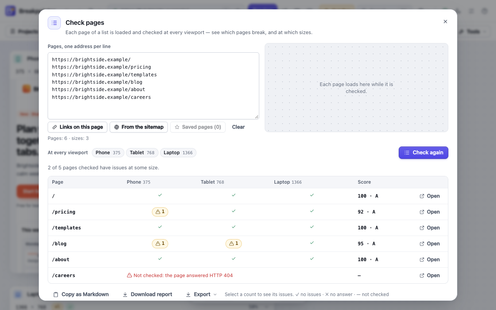       | 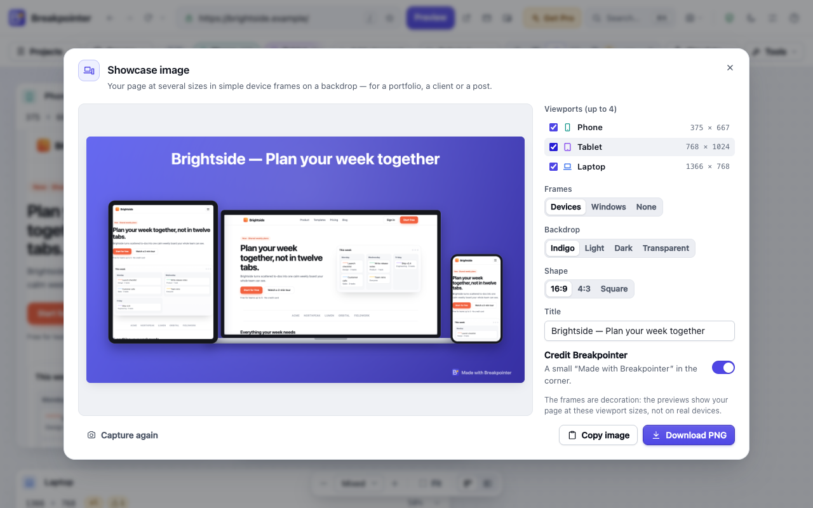 |
| 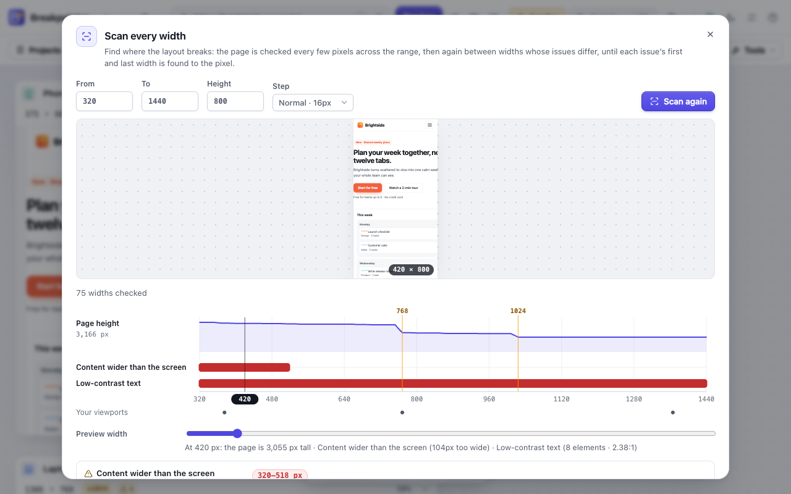 | 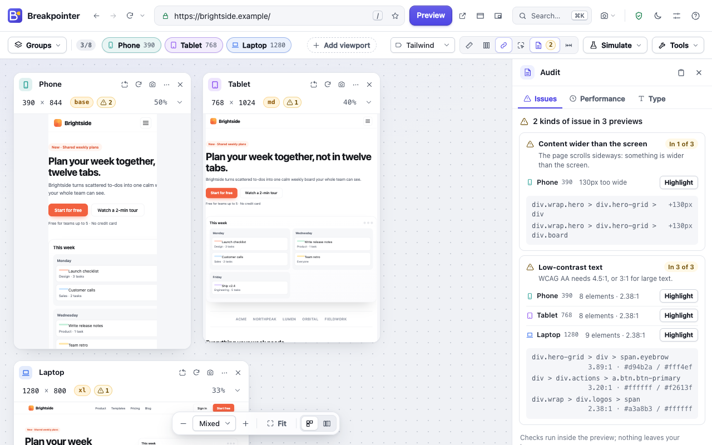                    |
| 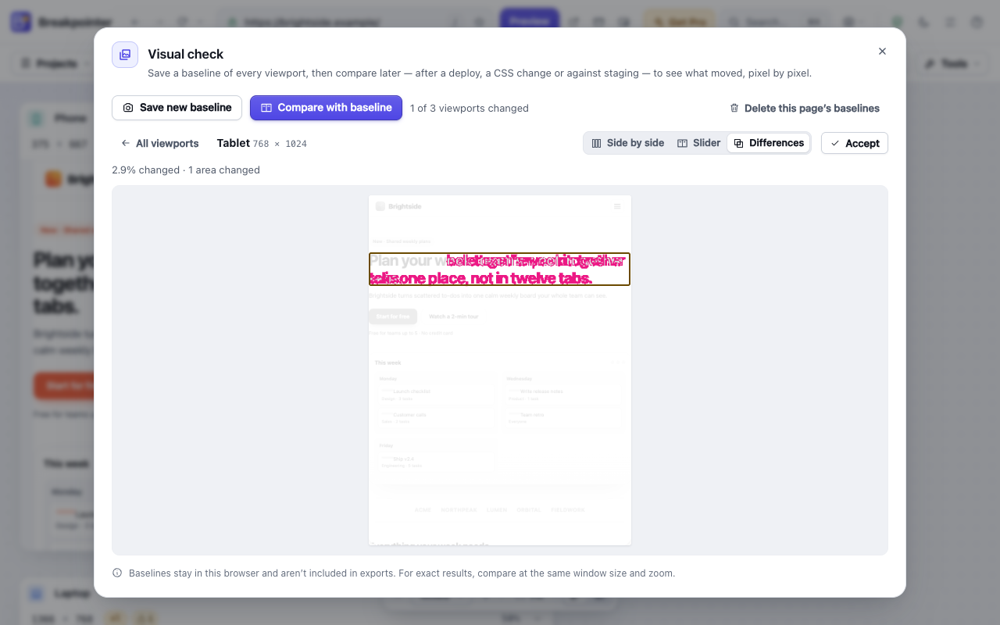                                              | 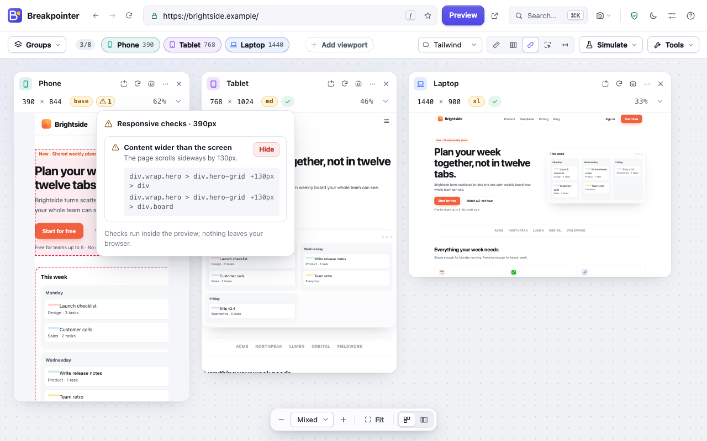       |
| 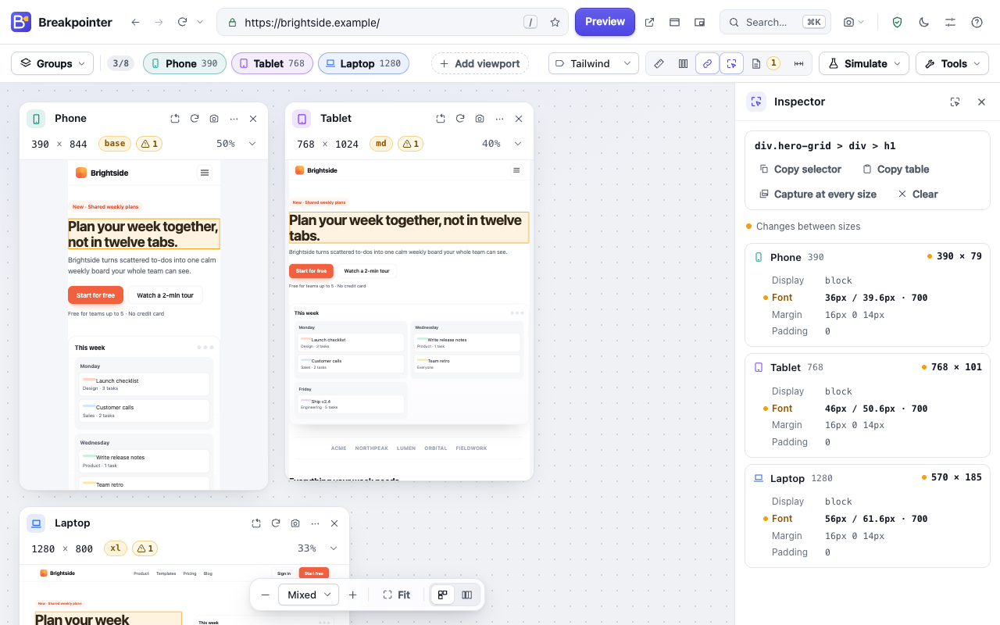                                         | 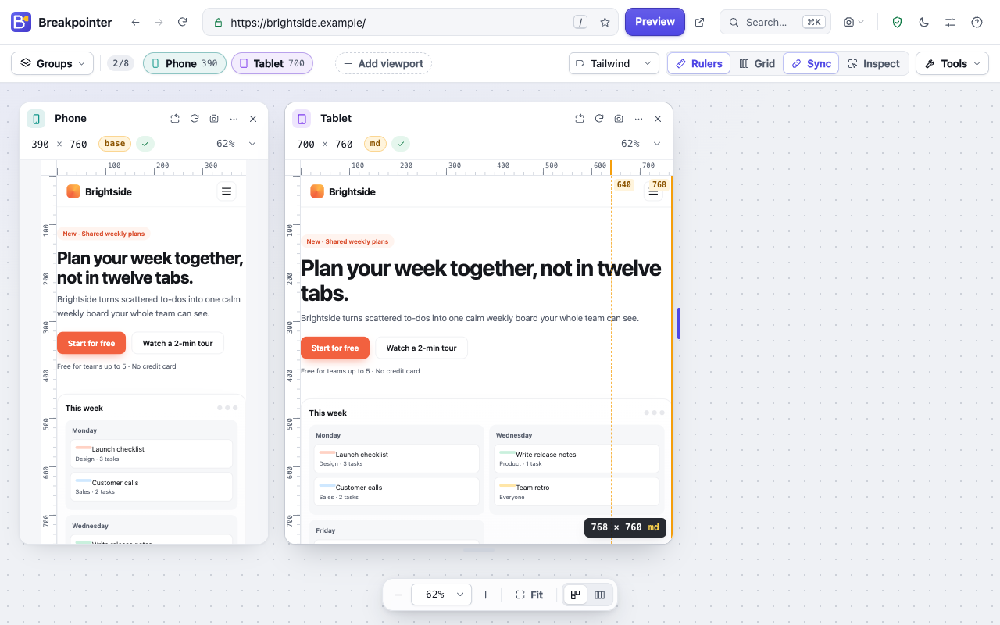               |
| 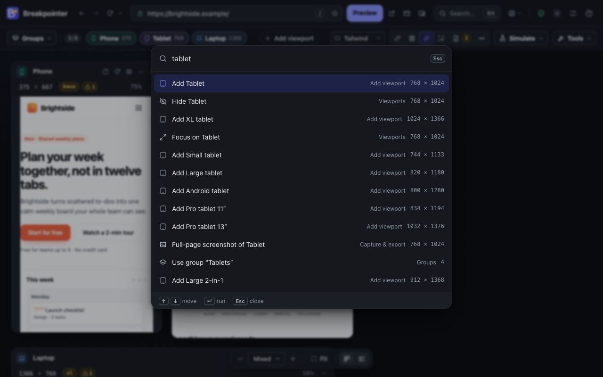                                                                | 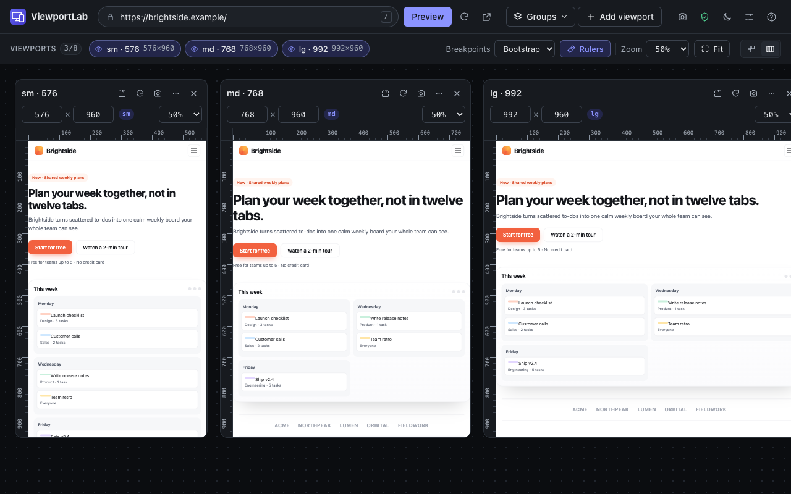                          |
| 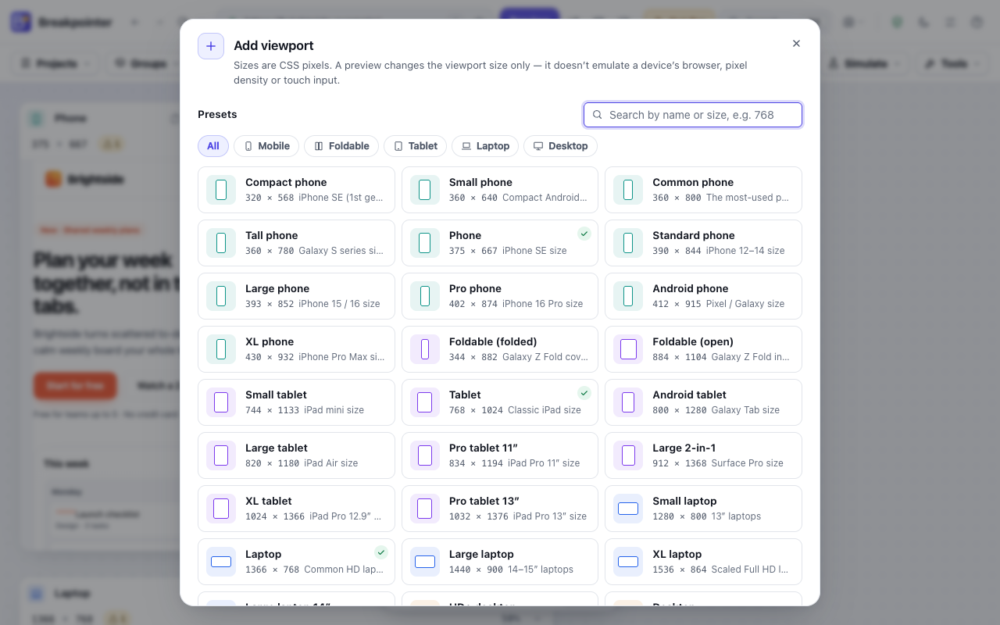                                                           | 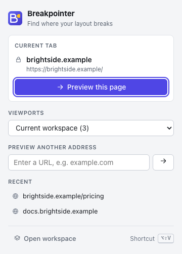                                                                           |

> **What it isn't:** Breakpointer changes the viewport size. It doesn't emulate a device's user agent, pixel density, touch input or browser engine, and sign-in state or third-party cookies can behave differently inside previews. See [How previews work](docs/ARCHITECTURE.md#adr-001-how-a-page-is-rendered-at-a-viewport-size).

## Install

**[Add Breakpointer to Chrome](https://chromewebstore.google.com/detail/naoadcallefanlcneemohjepkficejjh?utm_source=github&utm_medium=readme&utm_campaign=install)** from the Chrome Web Store — free. (Search for the full name, “Breakpointer — Responsive Viewport Tester”: another extension on the store is also called Breakpointer.)

**From source (developer mode)**

```sh
git clone https://github.com/Tanx-1811/breakpointer.git
cd breakpointer
npm ci
npm run build
```

Then open `chrome://extensions`, enable **Developer mode**, click **Load unpacked** and choose the **`dist` folder inside the project** (for example `~/Documents/GitHub/breakpointer/dist`), not the project folder itself — `manifest.json` only exists in `dist` after a build. On macOS, press ⌘⇧G in the folder picker to paste the path. Requires Chrome 116 or later.

After pulling changes, run `npm run build` again and click the reload icon on the Breakpointer card in `chrome://extensions`.

## Usage

1. Click the Breakpointer button (or press `Alt+Shift+V`) on any page and choose **Preview this page** — or type an address in the workspace.
2. Add sizes with **Add viewport**, apply a **Group**, or press **Fit** to see everything at once.
3. If a preview is blank or says "refused to connect", the site blocks framing: click **Allow on <site>**, or open it in a new tab or an exact-size window.

## Keyboard shortcuts

| In the workspace      |                                                   | Anywhere in Chrome |                          |
| --------------------- | ------------------------------------------------- | ------------------ | ------------------------ |
| `Ctrl/⌘ + K` or `K`   | Command palette                                   | `Alt+Shift+V`      | Open Breakpointer        |
| `/`                   | Focus the address bar                             | `Alt+Shift+P`      | Preview the current page |
| `R`                   | Reload all previews                               | `bpt` + space      | Address-bar keyword      |
| `A`                   | Add viewport                                      |                    |                          |
| `G`                   | Groups                                            |                    |                          |
| `F`                   | Fit to screen                                     |                    |                          |
| `+` / `−`             | Zoom in / out                                     |                    |                          |
| `L`                   | Switch layout                                     |                    |                          |
| `M`                   | Toggle rulers                                     |                    |                          |
| `I`                   | Inspect an element                                |                    |                          |
| `E`                   | Audit: issues, performance, type, images, colours |                    |                          |
| `W`                   | Scan every width                                  |                    |                          |
| `B`                   | Check pages                                       |                    |                          |
| `V`                   | Visual check against a baseline                   |                    |                          |
| `X`                   | Measure in a preview                              |                    |                          |
| `C`                   | Colour contrast checker                           |                    |                          |
| `O`                   | Toggle layout outlines                            |                    |                          |
| `[` / `]`             | Focus the previous / next viewport                |                    |                          |
| `1` … `8`             | Focus that viewport (again: show all)             |                    |                          |
| `0`                   | Zoom to 100%                                      |                    |                          |
| `P`                   | Floating preview (always on top)                  |                    |                          |
| `S`                   | Screenshot of the workspace                       |                    |                          |
| `T`                   | Switch theme                                      |                    |                          |
| `Esc`                 | Leave measuring, focus or the inspector           |                    |                          |
| `Alt + ←` / `Alt + →` | Previous / next previewed page                    |                    |                          |
| `?`                   | Help                                              |                    |                          |
| `Space` + drag        | Pan the workspace                                 |                    |                          |
| `Ctrl/⌘` + wheel      | Zoom all viewports                                |                    |                          |
| Drag a preview edge   | Resize (`Shift` 10px, `Alt` no snapping)          |                    |                          |

Chrome shortcuts can be changed at `chrome://extensions/shortcuts`.

## Permissions & privacy

No permission shows a warning at install. Host access is **optional** and requested only when you allow a site, allow all sites, or take your first screenshot (Chrome requires all-sites access to capture a tab).

| Permission                            | Used for                                                                                                                                                                                              |
| ------------------------------------- | ----------------------------------------------------------------------------------------------------------------------------------------------------------------------------------------------------- |
| `storage`                             | Your viewports, groups and preferences, stored locally                                                                                                                                                |
| `activeTab`                           | Reading the current tab's address when you invoke Breakpointer                                                                                                                                        |
| `contextMenus`                        | "Preview in Breakpointer" on pages and links                                                                                                                                                          |
| `declarativeNetRequestWithHostAccess` | Letting previews of sites **you allowed** ignore frame-blocking headers and frame checks, only inside the Breakpointer tab                                                                            |
| `sidePanel`                           | Showing a preview of the page you're browsing in Chrome's side panel                                                                                                                                  |
| `scripting`                           | Running Breakpointer's own script inside previews of sites **you allowed** (sync, checks, audit, width scan, inspector, breakpoints, colours, live CSS, stress tests), only while a workspace is open |

Breakpointer collects nothing and sends nothing anywhere. Breakpointer Pro adds no permission: licence keys are verified in the browser. Read the full [privacy policy](docs/PRIVACY.md).

## Development

```sh
npm ci
npm run dev           # rebuild dist/ on change (reload the extension in chrome://extensions)
npm run lint          # ESLint
npm run format        # Prettier
npm run typecheck     # TypeScript
npm test              # unit tests (Vitest)
npm run test:e2e      # end-to-end + accessibility tests (Playwright; run `npx playwright install chromium` once)
npm run build         # production build → dist/
npm run package       # build and zip → release/breakpointer-<version>.zip
npm run screenshots   # regenerate store screenshots from the real UI
npm run demo-video    # record brand/social/demo.mp4 and demo.gif from the real UI (needs ffmpeg)
npm run site          # build the landing page (site/ → dist-site/, deployed by GitHub Pages)
npm run brand         # regenerate logos, promo tiles and banners (macOS)
npm run license       # Breakpointer Pro: make the signing key, issue and check licence keys (docs/PRO.md)
npm run icons         # regenerate extension icons from assets/icon.svg
```

```
src/
  agent/        frame agent: the script that runs inside previews of allowed sites
  background/   service worker (context menus, omnibox, commands, rule cleanup)
  popup/        toolbar popup
  viewer/       the workspace page
  components/   UI components
  services/     preview adapter, embedding rules, site access, screenshots, storage
  state/        pure state logic (viewports, groups, fit, reducer)
  data/         presets, built-in groups, breakpoints
  i18n/         English and Vietnamese strings
tests/
  unit/         Vitest
  e2e/          Playwright (extension loaded in Chrome for Testing)
docs/           plan, architecture, privacy, store listing, testing, Pro (selling and licences)
brand/          brand guide, logos, store and social images
```

Read [ARCHITECTURE.md](docs/ARCHITECTURE.md) before changing how previews render or which permissions are used, and the [plan](docs/PLAN.md) for scope, decisions and the roadmap.

## Roadmap

V1 covers the preview workflow, v0.2 the inspection toolkit, v0.3 the redesign with the command palette, inspector, drag-to-resize, site breakpoints, A/B comparison, simulations, measuring and design overlays, v0.4 the width scanner, the audit panel, visual baselines, three new checks and access until Chrome closes, v0.5 Check pages, showcase images and feedback in the product, v0.6 Breakpointer Pro (accessibility checks, synced clicks and typing, hidden cookie banners, your brand on reports, CSV/JSON exports), v0.7 the responsive score, notes, projects and six more languages, and v0.8 the Images and Colours audits, performance budgets (Pro), the distance between two elements and a tour. Next, driven by feedback: per-group breakpoints, screenshots and baselines across pages, container-query breakpoints and more languages — see [docs/PLAN.md](docs/PLAN.md#9-roadmap-ideas-ordered-by-expected-value).

## Feedback

Found a bug, a site that won't show, or have an idea? [Open an issue](https://github.com/Tanx-1811/breakpointer/issues/new/choose) (Breakpointer → Help → Send feedback takes you there). If Breakpointer saves you time, a ⭐ on GitHub — and a rating once it's on the Chrome Web Store — helps other developers find it.

## License

No license has been chosen yet; all rights reserved by the author.

---

## Tiếng Việt

**Breakpointer** là tiện ích Chrome giúp xem trước website ở nhiều kích thước viewport cùng lúc. Mỗi bản xem trước có **viewport dàn trang thật**, nên media query và bố cục responsive hoạt động đúng như trong một cửa sổ cùng kích thước.

**Tính năng chính:** **kiểm tra nhiều trang** (`B`): cả danh sách trang — trang đã lưu, liên kết trong trang hoặc sitemap — ở mọi viewport trong một lần chạy, kèm bảng trang × kích thước và báo cáo HTML · **ảnh trình diễn**: trang ở nhiều kích thước trong khung thiết bị trên nền đẹp, cho portfolio hoặc bài đăng · xem song song tối đa 8 viewport · **quét mọi chiều rộng** (`W`) tìm chính xác đến từng pixel nơi mỗi vấn đề bắt đầu và kết thúc · **bảng rà soát** (`E`): mọi vấn đề, dung lượng, tốc độ, xê dịch bố cục và thang kiểu chữ ở mọi kích thước · **kiểm tra hình ảnh** (`V`): lưu ảnh mốc, so sánh sau, thấy phần nào xê dịch · kiểm tra mới: chữ bị cắt, chữ tương phản thấp, bố cục xê dịch · 28 kích thước có sẵn (tìm kiếm được) và kích thước tùy chỉnh · **kéo cạnh để đổi kích thước**, tự bắt dính vào breakpoint · **bảng lệnh** `Ctrl/⌘ + K` · **soi phần tử** ở mọi kích thước · **breakpoint của chính trang** · **xem sáng/tối cạnh nhau** · cuộn và điều hướng đồng bộ (giữ đúng nội dung đang xem) · **kiểm tra responsive** kèm đánh dấu trên trang (cả ảnh bị phóng mờ và phần tử cố định che màn hình) · **so sánh hai địa chỉ** (A/B, ví dụ staging cạnh bản chính thức) · **mô phỏng** thị lực (mù màu, nhìn mờ), giảm chuyển động, dừng hiệu ứng động, **thử độ bền bố cục** (chữ dài hơn ~40%, phải sang trái) · **cửa sổ thật** đúng kích thước cho trang cần đăng nhập, **xem trước nổi** luôn trên cùng (`P`), **thanh bên** xem nhanh trang đang mở · **chụp toàn trang** · giãn chữ (WCAG), tương phản cao, kiểu in · nhãn **kích thước ảnh** và **thứ tự Tab** · lưới baseline · **đo khoảng cách** (`X`), **kiểm tra độ tương phản màu** với ống hút màu (`C`), **phủ ảnh thiết kế** để so từng pixel · viền bố cục, lớp phủ grid & flex, CSS trực tiếp (lưu được đoạn CSS), lưới cột, thước đo, ẩn thanh cuộn · soi phần tử hiện margin/padding và chụp phần tử ở mọi kích thước · tải lại giữ nguyên chỗ đang xem (cả tự động) · liên kết workspace để chia sẻ · phím 1–8 tập trung một viewport · cho phép trang **đến khi đóng Chrome** · chế độ tập trung, quay lại/tới trang trước/sau, xoay tất cả, sắp theo chiều rộng · chụp ảnh, **ghép mọi viewport thành một ảnh**, chép vào bộ nhớ tạm, **xuất báo cáo HTML** · nhóm viewport, trang đã lưu (★) · menu chuột phải, phím tắt, gõ `bpt` + dấu cách trên thanh địa chỉ · giao diện sáng/tối mới · **tiếng Việt và tiếng Anh** · không thu thập dữ liệu.

**Mới ở 0.7:** **điểm responsive** 0–100 cho mỗi trang · **ghi chú & báo lỗi** (`N`): ghim chỗ có vấn đề lên bản xem trước và chép báo cáo lỗi dạng Markdown · **dự án**: lưu cả thiết lập của một website (một dự án miễn phí) · **chữ phóng to 200%** · breakpoint Material UI, Chakra UI, Ant Design, Bulma, Foundation · nhóm **kích thước phổ biến nhất** và **reflow WCAG** · giao diện thêm tiếng Tây Ban Nha, Bồ Đào Nha, Pháp, Đức, Nhật, Indonesia.

**Mới ở 0.8:** tab **Hình ảnh** trong phần rà soát: mỗi ảnh ở mọi viewport (quá lớn, quá nhỏ hay vừa) kèm gợi ý `sizes` và `srcset` để chép · tab **Màu sắc**: màu chữ, nền và viền, chép thành biến CSS · **khoảng cách giữa hai phần tử** ở mọi kích thước trong trình kiểm tra · **tour hướng dẫn** từ màn hình chào, Trợ giúp hoặc bảng lệnh · lưu bản xem trước kèm **ghi chú thành một ảnh**.

**Breakpointer Pro** (dùng thử miễn phí 7 ngày; mọi tính năng ở trên vẫn miễn phí): **kiểm tra trợ năng** ở mọi kích thước (ảnh thiếu alt, nút/liên kết không có tên, trường không có nhãn, tiêu điểm bàn phím rơi vào phần tử bị ẩn, trang thiếu ngôn ngữ) · **đồng bộ nhấp & gõ phím** giữa các bản xem trước (không bao giờ gửi biểu mẫu hai lần, không chép mật khẩu hay thông tin thanh toán) · **ẩn banner cookie** của 25+ công cụ phổ biến · **ngân sách hiệu năng** (dung lượng, số yêu cầu, LCP, CLS; bản xem trước vượt giới hạn được đánh dấu) · **thương hiệu riêng** (tên, website, logo) trên báo cáo và hình ảnh · **xuất CSV & JSON**. Khóa giấy phép được kiểm tra ngay trong trình duyệt — không tài khoản, không gửi gì đi.

**Cài đặt:** [thêm Breakpointer vào Chrome](https://chromewebstore.google.com/detail/naoadcallefanlcneemohjepkficejjh?utm_source=github&utm_medium=readme&utm_campaign=install) từ Chrome Web Store — miễn phí (tìm đúng tên đầy đủ “Breakpointer — Responsive Viewport Tester”, vì trên store có một tiện ích khác cũng tên Breakpointer).

**Cài đặt từ mã nguồn:** chạy `npm ci && npm run build`, mở `chrome://extensions`, bật **Chế độ dành cho nhà phát triển**, chọn **Tải tiện ích đã giải nén** và trỏ tới **thư mục `dist` bên trong dự án** (ví dụ `~/Documents/GitHub/breakpointer/dist`), không phải thư mục dự án — `manifest.json` chỉ có trong `dist` sau khi build. Trên macOS, nhấn ⌘⇧G trong hộp chọn thư mục để dán đường dẫn. Khi cập nhật code, chạy lại `npm run build` rồi bấm nút tải lại trên thẻ Breakpointer trong `chrome://extensions`.

**Cách dùng:** bấm nút Breakpointer (hoặc `Alt+Shift+V`) trên trang bất kỳ và chọn **Xem trước trang này**. Nếu bản xem trước trống hoặc báo "refused to connect", trang đó chặn hiển thị trong khung: bấm **Cho phép trên <trang>**, hoặc mở trong tab mới / cửa sổ đúng kích thước.

**Góp ý:** gặp lỗi hay có ý tưởng? [Tạo issue](https://github.com/Tanx-1811/breakpointer/issues/new/choose) (hoặc Trợ giúp → Gửi góp ý trong tiện ích). Nếu Breakpointer giúp ích cho bạn, một ⭐ trên GitHub sẽ giúp nhiều người tìm thấy nó hơn.

**Quyền riêng tư:** không tài khoản, không theo dõi, không máy chủ; quyền truy cập trang là tùy chọn và có thể gỡ bất cứ lúc nào. Xem [chính sách quyền riêng tư](docs/PRIVACY.md) và [kế hoạch sản phẩm](docs/PLAN.md).
